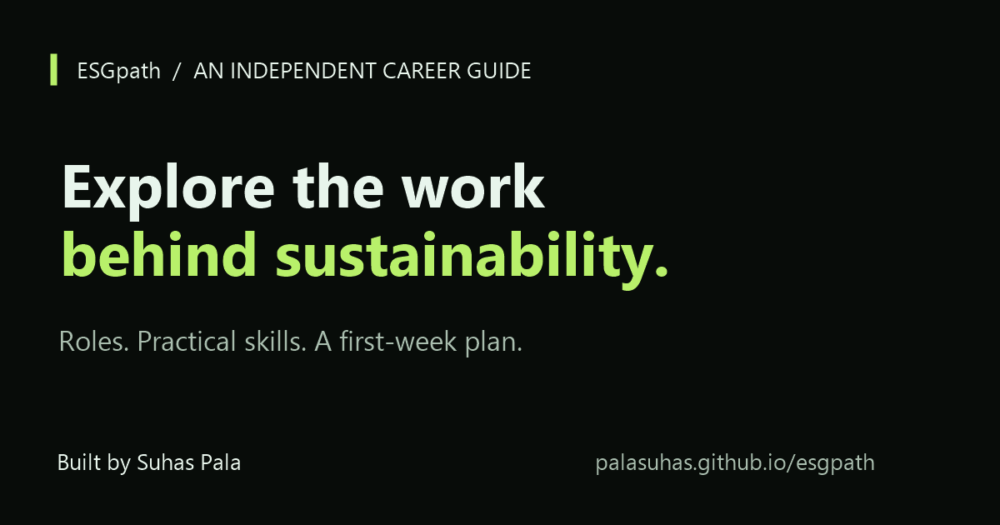

# ESGpath

**Purpose.** Help people exploring sustainability careers understand the work, compare possible roles and build a first evidence-based portfolio piece.

**Summary.**

- [Open the live guide](https://palasuhas.github.io/esgpath/) and compare three illustrative workdays.
- Explore practical skills, four company reading exercises and a five-step starting plan.
- Follow primary sources for reporting standards, company disclosures and learning programmes.
- A static, browser-only project by [Suhas Pala](https://suhaspala.com/). No account or AI service required.



## Try it

Start with **Explore the roles**, switch between analyst, consultant and in-house manager, then follow **Sources & scope** to inspect the evidence. The theme toggle remembers your choice when browser storage is available.

Use the arrow keys, Home and End within the role tabs. Without JavaScript, all three workdays remain readable. Reduced-motion preferences suppress animation.

## Why I built it

Sustainability job titles often hide very different day-to-day work. ESGpath connects the vocabulary with concrete tasks and gives a newcomer a way to practise questioning evidence. It demonstrates sustainability communication, information design and accessible browser interactions.

## Content and limitations

The workdays, progression and skill guidance are illustrative editorial content. They are not employer interviews, hiring forecasts or a prescribed career timeline. Company exercises point to company-reported publications; they are not independent verification or endorsements.

The guide deliberately omits unsupported salary ranges, job-growth estimates, market forecasts and course prices. Check provider pages and current local vacancies before making a purchase or career decision. Reporting requirements vary by jurisdiction and change over time. See [the source register](docs/sources.md) for the editorial review dated 24 November 2026.

## Run locally

There is no package installation or build step. With Python 3 installed, run from the repository root:

```sh
python -m http.server 8767 --bind 127.0.0.1
```

Open <http://127.0.0.1:8767/>. The public site deploys from the root of `main` through GitHub Pages. When changing CSS, update the `v` query value on both stylesheet links in `index.html` so visitors do not combine new HTML with cached older styles.

## Check changes

Python 3 and Node.js 20 or newer run the dependency-free checks:

```sh
python tools/check.py
node --test tools/browser-runtime.test.mjs
```

The checks cover markup structure, duplicate IDs and attributes, local assets and anchors, JavaScript syntax, and interactions when browser storage is unavailable. Before shipping a visual change, also check desktop and mobile layouts, both themes, role-tab keyboard navigation and browser errors. See [verification notes](docs/readiness.md).

## Privacy and reuse

Only the theme preference is stored locally. The app has no analytics script, backend, form submission or API key. GitHub Pages and Google Fonts receive normal web requests. An internet connection is needed for initial loading; offline support is not implemented.

Existing rights are unchanged. No open-source licence is granted by this update. Linked publications, standards and brand names retain their owners' rights; the project is not affiliated with those organisations.
